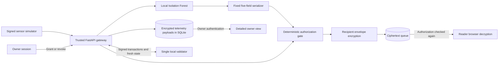
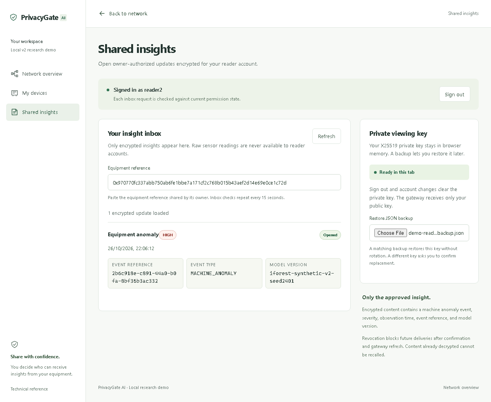

# PrivacyGate AI

**Blockchain-Based Privacy-Preserving IoT Intelligence Exchange**

Group 21 · Sambhav Surana · B.Tech, Artificial Intelligence & Data Science

Guide: Prof. Rohit Choubey

A Windows-native academic MVP: **signed sensor simulation → encrypted storage → local anomaly detection → custom blockchain authorization → recipient-encrypted insight**.

The owner sees detailed readings. A reader receives only an authorized five-field anomaly insight and decrypts it in their browser. Our own single-validator chain records signed permission changes; it never stores telemetry or insight content.

**Current implementation: native v2.** The approved [v2 implementation contract](docs/V2.md) and [ADR-015](docs/DECISIONS.md#adr-015--native-custom-chain-mvp-accepted-2026-10-26) supersede the older EVM, wallet and MQTT design. Legacy code remains in the repository but is outside the required v2 runtime. This is a local academic demonstration using synthetic data.

## Problem and approach

An equipment owner may want a maintenance reader to learn that a machine anomaly occurred without sharing every temperature, vibration and RPM reading. PrivacyGate AI separates anomaly detection from permission enforcement: the model proposes an event, while deterministic gateway checks decide whether a particular reader can receive it.

| View | Available information | Control |
|---|---|---|
| Owner | Detailed readings for owned equipment, registration and permission receipts | Register equipment, simulate packets, grant and revoke access |
| Reader | Recipient-encrypted anomaly insights under an active grant | Create or restore a local viewing key and open allowed insights |

The decrypted reader payload contains exactly `event_id`, `event_type`, `severity`, `observed_at` and `model_version`. Raw temperature, vibration and RPM stay outside this payload.

## Architecture



- **Input:** Ed25519 signatures, pinned device keys, schema and timestamp checks, and durable sequence/replay defense.
- **Storage:** AES-256-GCM encrypts raw payloads before SQLite writes.
- **AI:** CPU Isolation Forest classifies synthetic readings; a deterministic rule baseline supports evaluation. The model cannot grant access.
- **Authorization:** Signed, hash-linked blocks record registration, grants and revocations. Each publication and retrieval checks fresh signed state, policy digest, scope, expiry and versions.
- **Delivery:** Fresh ephemeral X25519, HKDF-SHA256 and AES-GCM encrypt each recipient's envelope. The browser holds its private key in memory.

See [architecture and trust boundaries](docs/ARCHITECTURE_V2.md) for outbox recovery, checkpoint behavior and failure modes.

## Run locally

Prerequisites: Windows PowerShell, uv, Node.js 24+/npm. Setup installs the locked Python 3.12 environment, web dependencies, and Playwright Chromium.

```powershell
./infra/scripts/v2/Setup.ps1
./infra/scripts/v2/Start.ps1 -Production
```

Open **http://127.0.0.1:3000**. Local passwords for `owner`, `reader`, and `reader2` are generated in the protected `var/v2/credentials.json`; do not share this file. No external blockchain, wallet, MQTT broker, Docker, or WSL is required.

Default loopback services:

| Service | Address |
|---|---|
| Web UI | `http://127.0.0.1:3000` |
| Gateway | `http://127.0.0.1:8000` |
| Permission validator | `http://127.0.0.1:8010` |

If ports are occupied:

```powershell
./infra/scripts/v2/Start.ps1 -Production -WebPort 3001 -GatewayPort 8001
$env:PG_WEB_URL = 'http://127.0.0.1:3001'
```

Setup preserves existing state. All services bind loopback. Stop only the recorded application processes:

```powershell
./infra/scripts/v2/Stop.ps1
```

`Reset.ps1 -ConfirmReset` explicitly deletes v2 data and keys. Legacy databases are never migrated or deleted automatically.

## Demonstrate

1. Owner signs in, adds equipment, runs normal/tampered simulation and inspects readings and registration receipt.
2. Reader creates a viewing key, explicitly saves its local backup, and registers only the public key.
3. Owner grants the reader access and emits an anomaly.
4. Reader enters the equipment reference and decrypts the five-field insight.
5. Owner revokes access; subsequent reader requests are denied.

Keep the reader backup private. Closing a tab or signing out clears its memory key; restore the matching backup to reopen insights.

[Five-minute walkthrough and reusable video script](docs/DEMO_V2.md) · [Architecture](docs/ARCHITECTURE_V2.md) · [Authoritative v2 protocol](docs/V2.md)

### Presentation and recorded demo

- [10-slide academic project presentation](docs/presentations/PrivacyGate_AI_Academic.pptx) — formal project overview with architecture, methodology, results and presenter notes.
- [Two-minute presentation speech](docs/presentations/SPEECH.md)
- [Recorded native v2 demonstration](docs/results/demo-privacygate-v2.webm)
- [Reader view screenshot](docs/results/playwright/v2-demo-reader.png)



## Verify

Stop the dev server before running the build gates:

```powershell
./infra/scripts/v2/Smoke.ps1
./infra/scripts/v2/Start.ps1 -Production
Push-Location apps/web
npx.cmd playwright test e2e/v2.spec.ts --reporter=line
Pop-Location
./infra/scripts/v2/Evaluate.ps1
uv run --locked python infra/scripts/v2/benchmark.py
```

Use the `PG_WEB_URL` override for browser tests when using alternate ports. The required live test fails if credentials/services are absent; mocked UI tests are separately labeled. The native Windows CI workflow repeats setup, checks, production startup and live browser acceptance.

[Execution evidence](docs/results/2026-10-26-v2-completion.md) records actual commands, results, benchmark boundaries and limitations. CI configuration is not proof that remote CI ran. Older v1 tests/docs are historical and superseded by docs/V2.md.

## Recorded results

### Improving the model over time

The local [reviewed retraining workflow](docs/LEARNING.md) lets an operator label
retained readings, evaluate a resource-specific candidate against the incumbent
and rule baseline, and explicitly activate it if validation F1 improves without
precision/recall or synthetic regression losses. Encrypted versioned recipes load
on restart, expire within seven days of source collection, and support rollback.
This is controlled batch learning; incoming packets do not automatically retrain
the model. Historical measurements below remain results for the original model.

These are retained results from **26 October 2026**, not a fresh run on every checkout. The execution report records 28 Python tests passing and a final browser run with 11 passed cases and one optional case skipped. See the report for command scope and provenance.

The model trained on 512 synthetic normal samples and used a disjoint holdout of 256 normal and 128 anomalous samples.

| Method | TP | FP | TN | FN | Precision | Recall | F1 |
|---|---:|---:|---:|---:|---:|---:|---:|
| Isolation Forest | 128 | 5 | 251 | 0 | 0.9624 | 1.0000 | 0.9808 |
| Rule baseline | 128 | 0 | 256 | 0 | 1.0000 | 1.0000 | 1.0000 |

The rule baseline performs better on this deliberately separable holdout. These results do not establish real equipment accuracy or predictive maintenance capability. [Model evaluation and seeds](docs/results/v2-model-evaluation.json).

| Independently measured stage | Samples | p95 |
|---|---:|---:|
| Grant HTTP request to durable commit | 10 | 22.89 ms |
| Signed simulation through encrypted dispatch | 40 | 49.96 ms |
| Authorized envelope HTTP fetch | 40 | 14.28 ms |

Measurements use sequential bursts on one Windows host. Separate stage percentiles cannot be added to obtain an end-to-end percentile, and do not establish sustained throughput. [Benchmark data and environment](docs/results/v2-benchmarks.json).

## Repository map

| Path | Purpose |
|---|---|
| `apps/gateway/src/privacygate_v2/` | Current gateway, ledger, schemas, security, storage and model |
| `apps/gateway/tests/v2/` | Current backend and security tests |
| `apps/web/` | Next.js owner/reader UI and browser acceptance tests |
| `infra/scripts/v2/` | Windows setup, service lifecycle, smoke checks and evaluation |
| `tests/v2/` | Real process flow and process identity tests |
| `docs/results/` | Dated execution evidence, evaluation, screenshots and recording |
| `packages/contracts/`, `apps/simulator/`, `apps/gateway/src/privacygate/` | Historical v1 components |

The current HTTP and data contracts are in [V2.md](docs/V2.md). [TASKS.md](docs/TASKS.md#native-v2-completion-gates-supersede-legacy-runtime-tasks) maps the approved v2 workstreams; older unchecked milestones describe the historical design.

## Trust and limitations

- Single-validator chain: centralized authority, not distributed consensus.
- Trusted gateway holds owner signing keys and raw data in memory; host compromise defeats that boundary.
- Raw payload encryption does not hide SQLite metadata or encrypt the entire file.
- Revocation blocks future release, not previously received copies or already-authorized responses in flight.
- Reader private keys are not uploaded or stored in browser storage. User-requested backups are plaintext secrets.
- Model evaluation uses synthetic, deliberately separated distributions. The rule baseline outperforms Isolation Forest on this holdout; neither establishes real equipment accuracy.
- Valid-prefix rollback detection requires a retained checkpoint. Compromised validator keys and rewritten checkpoints are outside the trust model.
- One gateway worker is supported. No production certification or public deployment is claimed.
