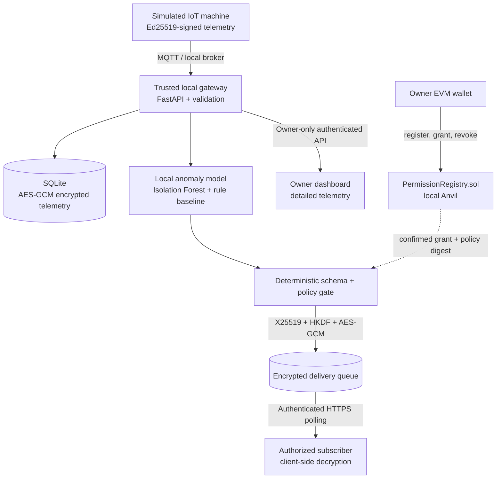

# PrivacyGate AI

**Blockchain-Based Privacy-Preserving IoT Intelligence Exchange**

> **One device. One useful insight. Only the readers the owner authorized.**
>
> **Project status:** Academic MVP in the **planning/specification stage**. This repository's current deliverables are design documents and development contracts; application services, smart contracts, dashboards, and test commands described below are **planned**, not yet implemented or validated.

PrivacyGate AI explores how an IoT owner can share **useful AI-derived events** with independent applications without granting them unrestricted access to raw sensor measurements. A local gateway validates signed device messages, stores readings encrypted, detects anomalies, enforces a narrowly scoped owner-approved policy, and encrypts each permitted insight for its recipient. A blockchain smart contract acts as a shared **authorization record**—not a sensor-data database or messaging network.

The first demonstration uses a **simulated industrial machine** (temperature, vibration, RPM), **one owner**, and **one restricted subscriber**. The owner can view detailed local readings; the subscriber can obtain only a specifically authorized `MACHINE_ANOMALY` event.

## Why this project?

IoT integrations often request wide access to data even when a maintenance company, insurer, or monitoring service needs only a yes/no event or a coarse alert. This creates privacy risks, unnecessary data transfer, and disputes about who was permitted to see which information.

**Problem statement:** How can independently operated devices and services exchange actionable intelligence while limiting unnecessary disclosure, giving the data owner granular grant/revoke control, and providing independently inspectable authorization records?

**Our single MVP feature:** **Owner-controlled delivery of a schema-limited, AI-generated anomaly insight to an authorized third party—without disclosing the source telemetry.**

## What the demo should show

1. A simulated device signs and publishes temperature, vibration, and RPM readings.
2. The local gateway verifies publisher identity, timestamps, and sequence numbers and stores the telemetry encrypted in SQLite.
3. A local Isolation Forest model (with a deterministic rule-based baseline) detects a candidate machine anomaly.
4. The owner approves an off-chain, narrowly defined policy and signs a `READ_INSIGHT` grant through an EVM wallet.
5. The gateway verifies the **confirmed** on-chain grant, the exact policy digest, recipient, resource, scope, and expiry; it then builds the allowed five-field output.
6. The subscriber obtains a **recipient-encrypted** insight over an authenticated API and decrypts it locally. The owner's detailed readings stay private.
7. After a confirmed revocation, new deliveries and unread queued envelopes are blocked. Information already decrypted by a recipient cannot be recalled.

### Data minimization in practice

| Private on the owner's gateway | Allowed subscriber insight |
| --- | --- |
| `temp_c`, `vibration_mm_s`, `rpm` | `event_id` |
| Signed source measurements and sequences | `event_type` (`MACHINE_ANOMALY`) |
| Detailed numeric feature values | `severity` (`LOW`, `MEDIUM`, or `HIGH`) |
| Detailed internal anomaly score | `observed_at` |
| Device/source details | `model_version` |

No raw measurements, free-form AI explanation, or arbitrary AI-generated fields are permitted in the third-party payload. **The model proposes an event; deterministic code decides what may leave the gateway.**

## Proposed architecture



**Two planes, different jobs:**

- **Data plane (off-chain):** MQTT ingestion, encrypted local storage, inference, schema validation, encrypted delivery.
- **Control plane (on-chain):** owner, `READ_INSIGHT` grant/revoke, policy digest, expiry and version.

A **local Anvil chain does not demonstrate decentralization or distributed consensus**. Blockchain becomes useful as a shared permission registry only when independent parties can inspect and trust the deployed network's history. A regular access-control database is a legitimate simpler baseline; the project plans to compare both approaches.

## Identity, permissions and cryptography

| Participant | Identity / key | Rights in MVP |
| --- | --- | --- |
| Device publisher | Pinned **Ed25519** public key | Publish signed telemetry only |
| Owner | EVM wallet + authenticated session | Own resource, view detailed telemetry, grant/revoke reader access |
| Subscriber | Separate EVM wallet + **X25519** public key | Read only active, authorized, individually encrypted insights |
| Local gateway | Trusted execution process | Verify messages, run AI, enforce policy and encrypt permitted outputs |
| Smart contract | Solidity registry | Record and expose the current grant state and events |

Raw readings are encrypted at the application layer with **AES-256-GCM** before SQLite persistence. For each permitted delivery, the gateway plans to use an ephemeral **X25519** key exchange, **HKDF-SHA256** and **AES-GCM** to encrypt the five-field insight for its recipient. EVM wallet login uses a one-time signed challenge with server-side session protection. Secrets and private keys must **never** be committed or submitted to the API.

The policy gate must verify the confirmed contract state **at creation and retrieval**, and it must **fail closed** for third-party disclosure if authorization cannot be checked. See [DESIGN.md](DESIGN.md), [API.md](API.md), and [DECISIONS.md](DECISIONS.md) for the exact trust and authorization rules.

## Planned technology stack

| Layer | Technology | Purpose |
| --- | --- | --- |
| Device simulator | Python 3.11+ | Deterministic synthetic sensor streams and Ed25519 signing |
| Messaging | MQTT + Eclipse Mosquitto | Local device-to-gateway transport |
| Gateway / API | Python, FastAPI, Pydantic v2 | Authentication, validation, policy enforcement, encrypted delivery |
| Storage | SQLite + application-layer AES-GCM | Local encrypted reading and encrypted delivery storage |
| Local AI | scikit-learn Isolation Forest + rule baseline | Anomaly candidates, evaluated on synthetic fixtures |
| Smart contract | Solidity + Foundry | Owner/resource registry and narrow grants |
| Development chain | Anvil (chain ID `31337`) | Isolated Ethereum-compatible demonstration network |
| Frontend | Next.js, React, TypeScript | Owner and subscriber interfaces |
| Tests | pytest, Foundry, Playwright | Unit, contract, security-negative and end-to-end verification |
| Tooling | Docker Compose, `uv`, `pnpm` | Reproducible local development |

**Inference stays local.** The MVP does not need a hosted LLM or cloud inference API. The AI does **not** decide access rights, sign transactions, execute arbitrary SQL, or control physical machinery.

## Repository structure (target)

```text
privacygate-ai/
├── README.md                      # You are here
├── AGENTS.md                      # Coding-agent rules and implementation workflow
├── SPEC.md                        # Product requirements and acceptance criteria
├── Project-Structure.md           # Full proposed repository tree
├── DESIGN.md                      # Architecture, trust boundaries and cryptography
├── API.md                         # Proposed HTTP, MQTT and contract interfaces
├── DATA_MODEL.md                  # Canonical schemas and persistence model
├── DECISIONS.md                   # Accepted architecture decisions (ADRs)
├── TASKS.md                       # Dependency-aware task roadmap
├── TESTING.md                     # Test matrix and expected evidence
├── CONVENTIONS.md                 # Style, commit and security standards
├── MISTAKES.md                    # Known pitfalls and incident notes
├── .env.example                   # Configuration template; no real secrets
├── apps/                          # [planned] gateway, simulator, web
├── packages/                      # [planned] contracts and shared schemas
├── infra/                         # [planned] dev services and scripts
├── tests/                         # [planned] E2E, security, performance
└── docs/results/                  # [planned] measured verification reports
```

Only the documentation and `.env.example` are included in the current **developer pack**; additional directories/files are created in implementation tasks. See [Project-Structure.md](Project-Structure.md) for the authoritative intended layout.

## Getting started

### A. Start development from this docs-only pack (available now)

1. Download/extract the developer pack and create a Git repository containing these files.
2. Read [AGENTS.md](AGENTS.md) and [SPEC.md](SPEC.md), then [DECISIONS.md](DECISIONS.md), [DESIGN.md](DESIGN.md) and [TASKS.md](TASKS.md).
3. Implement **PG-001 → PG-002 → PG-003**: repository scaffolding, local development services, and shared contract fixtures.
4. Implement the smart-contract ownership prerequisite before device enrollment, as specified in `TASKS.md`.
5. Keep all feature checkboxes **uncompleted** until their positive, negative, and integration tests pass.

**Suggested first coding-agent prompt:**

```text
Read AGENTS.md, SPEC.md, DECISIONS.md, DESIGN.md, API.md,
DATA_MODEL.md, TESTING.md and TASKS.md. Follow the specified
contracts. Begin with PG-001, PG-002 and PG-003 only. Create the
smallest runnable repository foundation, safe local services and
golden schema fixtures. Do not claim planned capabilities work until
corresponding tests pass; document all decisions and failures.
```

### B. Local runtime quickstart (planned — commands are not runnable yet)

Prerequisites for the implemented stack: **Python 3.11+**, `uv`, Node.js + `pnpm`, **Docker Compose**, **Foundry** (`forge`, `anvil`) and an EVM-compatible wallet. On Windows, **WSL2** is recommended for shell scripts and Foundry tooling.

The following describes the intended developer interface **after PG-002 and deployment/bootstrap scripts are implemented**:

```bash
# Clone your future repository, then from its root:
cp .env.example .env
# Generate your own unique development-only keys; complete required .env fields.
# Never use real wallet seed phrases or copy keys from screenshots.

docker compose up -d mqtt anvil

# Once the project bootstrap/deploy script is implemented:
# Deploy PermissionRegistry on the local Anvil chain and update the
# contract address in .env and frontend/gateway configuration.
# Then launch the gateway, simulator and web app with their documented scripts.
```

**Important:** `.env.example` intentionally leaves `SESSION_SIGNING_SECRET`, `GATEWAY_DATA_KEY_B64`, `SIMULATOR_ED25519_PRIVATE_KEY_B64`, IDs and contract addresses blank. Do not fill these with guessed/example production secrets. `.env` must be in `.gitignore`. MQTT at `127.0.0.1:1883` and the HTTP gateway at `127.0.0.1:8000` are development defaults; do not expose them publicly without transport security and network controls.

Expected local addresses **after services exist**:

| Service | Planned local endpoint |
| --- | --- |
| Owner/subscriber web UI | `http://127.0.0.1:3000` |
| Gateway REST API | `http://127.0.0.1:8000/v1` |
| Local MQTT broker | `127.0.0.1:1883` |
| Local Anvil JSON-RPC | `http://127.0.0.1:8545` |

## API snapshot (proposed v1)

| Interface | Purpose |
| --- | --- |
| `POST /v1/auth/challenge`, `POST /v1/auth/verify` | Wallet challenge login |
| `POST /v1/devices`, `GET /v1/devices` | Owner-enrolled device management |
| `GET /v1/resources/{resource_id}/telemetry` | **Owner-only** detailed readings |
| `POST /v1/keys` | Reader's wallet-bound X25519 public key |
| `POST /v1/policies`, `POST /v1/policies/{policy_id}/sync` | Local policy draft and confirmed on-chain synchronization |
| `GET /v1/policies` | Owner policy status |
| `GET /v1/insights` | **Subscriber-only encrypted envelopes**, never raw/plaintext insights |
| `GET /v1/audit/permission-events` | Owner-accessible authorization history |
| `GET /v1/health`, `GET /v1/ready` | Liveness and dependency readiness |
| MQTT `devices/{device_id}/telemetry` | QoS 1, signed readings; no retained sensor messages |
| `PermissionRegistry.sol` | `registerResource`, `grant`, `revoke`, `ownerOf`, `getGrant` |

Request/response examples, wallet authorization, confirmation rules, field names, pagination and error codes are specified in [API.md](API.md) and [DATA_MODEL.md](DATA_MODEL.md). Do **not** build frontend permissions from visual UI state alone.

## Testing and definition of success

**All tests are planned until executed.** The definitive acceptance matrix is [TESTING.md](TESTING.md), cases **T-01 through T-24**.

Required high-value outcomes:

- Reject changed signatures, duplicate sequences, incorrect MQTT topic/device pairing and expired timestamps.
- Verify plaintext raw telemetry is absent from SQLite payloads, subscriber endpoints, retained broker messages, logs and contract events.
- Confirm that an unauthorized wallet cannot grant/revoke access; no grant or mismatched digest means **no insight disclosure**.
- Prove that only the intended X25519 recipient decrypts the **exact five-field** result.
- Verify confirmed expiry/revocation prevents newly generated and unread deliveries; a chain RPC outage denies third-party access.
- Show the owner-only telemetry view, end-to-end demo and a restart/replay test.
- Evaluate AI predictions against a rule baseline with confusion matrix, precision, recall, F1, and reproducible synthetic fixtures.
- Measure p50/p95/p99 latencies and compare contract-backed authorization with a centralized ACL baseline. Report observed numbers, **not invented benchmarks**.

Once test tooling exists, the intended entry points include `forge test`, `uv run pytest`, `pnpm test`, and `./infra/scripts/smoke.sh` (WSL2 for `.sh` on Windows). Save evidence under `docs/results/`.

## Roadmap

| Phase | Outcome | Tracking |
| --- | --- | --- |
| 0 | Repository, environment, shared fixtures | PG-001–PG-003 |
| 1 | Signed ingestion and encrypted local storage | PG-010–PG-013 |
| 2 | Local AI and strict insight serializer | PG-014–PG-016 |
| 3 | Permission contract, wallet auth, policy confirmation | PG-020–PG-024 |
| 4 | Recipient encryption, API, expiration/revocation | PG-030–PG-034 |
| 5 | Dashboards, end-to-end tests, benchmarks and academic demo | PG-040–PG-045 |

The dependency-aware task checklist is in [TASKS.md](TASKS.md). The MVP is **not complete** until security-negative tests and a reproducible demonstration pass.

## Limitations and non-goals

- **Trusted gateway:** A compromised gateway/host can access local plaintext and encryption keys; blockchain does not prevent secret exfiltration.
- **Sensor truth:** A signature proves message origin/integrity, not that a sensor is calibrated or honest.
- **Prediction quality:** Synthetic anomaly performance is not certified fault detection or seven-day failure prediction.
- **No retroactive deletion:** Revocation stops future authorized access after confirmation/synchronization; it cannot delete earlier plaintext held by a reader.
- **On-chain metadata:** Wallet addresses, policy digests and timings may still reveal relationships; do not put personal data or raw sensor values on-chain.
- **Local demonstration:** Anvil is a single local development chain, not a production decentralized network or consensus guarantee.
- **Not in MVP:** Payments/data marketplace, multiple device organizations, autonomous physical control, general-purpose LLM SQL, decentralized data storage, hardware attestation, production key recovery, and public mainnet deployment.

This is a **research and educational prototype**, not a production-certified privacy, industrial safety, or regulatory compliance solution. See [DESIGN.md](DESIGN.md) and [MISTAKES.md](MISTAKES.md) for threat assumptions and common implementation mistakes.

## Documentation index

| File | Read it for |
| --- | --- |
| [AGENTS.md](AGENTS.md) | Instructions and guardrails for coding agents |
| [SPEC.md](SPEC.md) | Problem, MVP, personas and functional requirements |
| [Project-Structure.md](Project-Structure.md) | Planned directories and boundaries |
| [DESIGN.md](DESIGN.md) | System architecture, cryptography and failure behavior |
| [API.md](API.md) | Endpoints, MQTT format, wallet and contract interface |
| [DATA_MODEL.md](DATA_MODEL.md) | Data schemas, storage and canonicalization |
| [DECISIONS.md](DECISIONS.md) | Architectural decision records and trade-offs |
| [TASKS.md](TASKS.md) | Dependencies, milestones and implementation order |
| [TESTING.md](TESTING.md) | Test cases, security invariants and benchmark methodology |
| [CONVENTIONS.md](CONVENTIONS.md) | Coding, documentation and security conventions |
| [MISTAKES.md](MISTAKES.md) | Pitfalls, lessons learned and future incident notes |
| [.env.example](.env.example) | Local configuration template (no secrets) |

## Academic information

| Field | Value |
| --- | --- |
| **Project** | PrivacyGate AI — Blockchain-Based Privacy-Preserving IoT Intelligence Exchange |
| **Student** | Sambhav Surana |
| **Enrollment number** | 23100BTCSAII14318 |
| **Group** | 24 (individual project) |
| **Department** | Artificial Intelligence & Data Science |
| **Program** | B.Tech, 4th Year / 7th Semester |
| **University** | Shri Vaishnav Vidyapeeth Vishwavidyalaya |
| **Project guide** | Prof. Rohit Choubey |

## Working on the project

Start with a `PG-###` task from [TASKS.md](TASKS.md), obey the security constraints in [AGENTS.md](AGENTS.md), add positive **and negative** tests, and update the relevant docs whenever an interface or trust decision changes. Record new architectural choices in [DECISIONS.md](DECISIONS.md), and failures/lessons in [MISTAKES.md](MISTAKES.md).

**License:** Not selected yet; do not assume code or documentation are open-source licensed until a `LICENSE` file is added.
