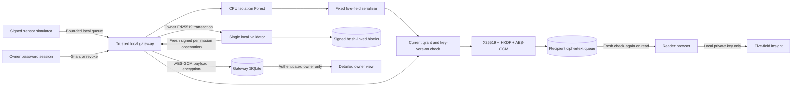

# Native v2 architecture

The validator is a separate process so outage is a real failure boundary. Its
SQLite commit atomically stores a signed block, transaction index, signer nonce,
and derived permission state. Startup replay validates the chain and projections.
The gateway pins genesis/validator identity and persists observed-head checkpoints.

Gateway and validator databases cannot share a distributed transaction. The
gateway first persists exact signed outbox bytes and a client operation ID;
idempotent submission and receipt reconciliation handle lost responses and
restarts. An expired, provably uncommitted operation becomes a terminal failure;
it does not permanently block subsequent signer operations.

Disclosure requires the current resource, owner, recipient, policy digest,
scope, expiry, grant version and recipient-key version to match. Revocation and
regrant cannot revive earlier queues. Uncertain state returns no ciphertext.
The authorization observation immediately before release is the linearization
point; already-authorized in-flight responses cannot be recalled.

Passwords establish local account sessions; they are not encryption keys. The
trusted gateway holds owner signing keys. The reader's decryption key stays in
browser memory and an explicitly downloaded local backup. Raw telemetry is
encrypted before persistence; metadata is still visible in SQLite. Only signed
permission changes enter the blockchain.

One validator does not provide consensus or protection against its own key/host
being compromised. A separately retained checkpoint is needed to detect a valid
prefix rollback; rewriting both history and checkpoints with compromised keys is
outside the trust model. Synthetic model accuracy does not establish sensor
truth, maintenance diagnosis, safety, or field predictive performance.
