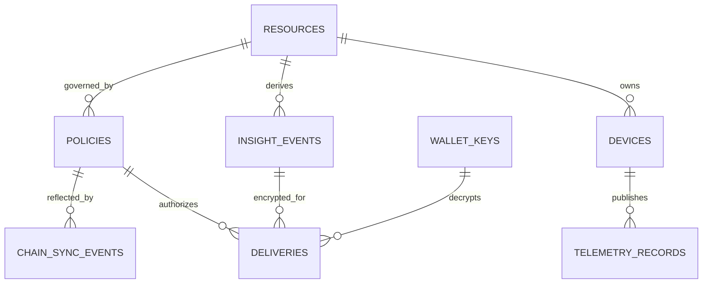

# DATA_MODEL.md — Canonical Schemas and Persistence

> **Planned schemas.** Database details may evolve through migrations, but the external DTOs, field semantics, privacy boundaries and test fixtures below are normative for MVP v1.

## 1. Core entities and relationships



Resource may have only **one device** in MVP, but model permits expansion later. One owner wallet owns a resource; many policy revisions and deliveries are possible.

## 2. SQLite tables (proposed)

| Table | Key fields | Constraints and privacy |
|---|---|---|
| `resources` | `resource_id TEXT PK`, `owner_wallet TEXT`, `label TEXT`, `created_at TEXT` | 32-byte hex ID; owner wallet normalized; labels must be synthetic in demo |
| `devices` | `device_id TEXT PK`, `resource_id FK`, `ed25519_public_key BLOB`, `last_sequence INTEGER`, `active INTEGER` | Public key exactly 32 bytes; `last_sequence >= 0`; pinned device-to-resource mapping |
| `telemetry_records` | `record_id TEXT PK`, `device_id FK`, `sequence INTEGER`, `issued_at TEXT`, `nonce BLOB`, `encrypted_payload BLOB`, `created_at TEXT` | `UNIQUE(device_id,sequence)`; ciphertext of raw JSON; no plaintext numeric telemetry columns |
| `insight_events` | `event_id TEXT PK`, `resource_id FK`, `event_type TEXT`, `severity TEXT`, `observed_at TEXT`, `model_version TEXT`, `created_at TEXT` | **Gateway-local candidate** metadata, never a direct third-party API resource |
| `policies` | `policy_id TEXT PK`, `resource_id FK`, `owner_wallet`, `recipient_wallet`, `policy_revision INTEGER`, `policy_json TEXT`, `policy_digest TEXT`, `status TEXT`, `contract_version INTEGER NULL`, `confirmed_block INTEGER NULL`, `expires_at_unix INTEGER`, `created_at TEXT` | Policy JSON holds only approved event/field names and synthetic IDs; digest immutable per revision |
| `wallet_keys` | `wallet_address TEXT PK`, `key_id TEXT`, `x25519_public_key BLOB`, `created_at TEXT`, `rotated_at TEXT NULL` | Public key 32 bytes; key rotation invalidates unserved deliveries |
| `deliveries` | `delivery_id TEXT PK`, `policy_id FK`, `event_id FK`, `recipient_wallet TEXT`, `policy_version INTEGER`, `key_epoch INTEGER`, `ephemeral_public_key BLOB`, `nonce BLOB`, `aad BLOB`, `ciphertext BLOB`, `created_at TEXT`, `invalidated_at TEXT NULL` | **Ciphertext only**; index `(recipient_wallet,created_at)`; authorized retrieval checks chain afresh |
| `key_epochs` | `resource_id TEXT`, `recipient_wallet TEXT`, `epoch INTEGER`, `updated_at TEXT` | Composite PK `(resource_id,recipient_wallet)`; increment on revoke/recipient key change |
| `chain_sync_events` | `id TEXT PK`, `resource_id`, `reader_wallet`, `event_type`, `tx_hash`, `block_number`, `contract_version`, `observed_at` | Unique `(tx_hash,event_type,reader_wallet)`; no telemetry |
| `auth_challenges` | `challenge_id TEXT PK`, `wallet_address`, `message_hash`, `nonce_hash`, `expires_at`, `consumed_at NULL` | No reusable plaintext nonce storage unless essential; atomic single-use verification |
| `web_sessions` | `session_id_hash TEXT PK`, `wallet_address`, `expires_at`, `revoked_at NULL`, `csrf_token_hash` | Session tokens/cookie content never stored in plaintext |

For all tables, `created_at` and `updated_at` (where present) are ISO UTC or DB-native integer UTC timestamps consistently chosen in implementation. Migrations need foreign-key enforcement (`PRAGMA foreign_keys=ON`).

### Encrypting telemetry at rest

- The raw reading is encrypted in a single payload using AES-256-GCM: `encrypted_payload`, unique random 12-byte `nonce`, and AAD bound to `device_id`, `sequence`, `resource_id` and schema version.
- Application data-encryption key is provided by `GATEWAY_DATA_KEY_B64` (32 random bytes in base64). No plaintext copy in `telemetry_records`, `insight_events`, or audit logs.
- This is **column/payload encryption**, not SQLCipher/full-file encryption; other DB metadata may be readable.

## 3. Pydantic / JSON schema contract

### `SensorTelemetryV1`

| Field | Type/rule | Privacy classification |
|---|---|---|
| `temp_c` | finite float in [-40, 200] | Raw, owner-only |
| `vibration_mm_s` | finite float in [0, 100] | Raw, owner-only |
| `rpm` | integer in [0, 30000] | Raw, owner-only |

### `SignedTelemetryV1`

- `schema_version: Literal[1]`
- `device_id: UUID`
- `resource_id: 0x-prefixed, exactly 32-byte lowercase hex`
- `sequence: int > 0`
- `issued_at: UTC timestamp with millisecond formatting`
- `telemetry: SensorTelemetryV1`
- `signature_b64: exactly 64 bytes decoded Ed25519 signature`

Canonical signable object excludes the signature field. Empty, NaN/Infinity, unknown fields, too-future/too-old timestamps and wrong device-resource binding are invalid.

### `InsightV1` — the **only** subscriber-decryptable application payload

```json
{
  "event_id": "c0b3ec22-2bce-4291-a654-5b8c21663045",
  "event_type": "MACHINE_ANOMALY",
  "severity": "HIGH",
  "observed_at": "2026-10-14T12:00:00.000Z",
  "model_version": "isolation-forest-v1"
}
```

- Forbid additional properties (`extra=forbid`).
- `event_type`: `MACHINE_ANOMALY` only in MVP; `severity`: enum `LOW`, `MEDIUM`, `HIGH`.
- Do not include model score/confidence, source readings, GPS, device ID, arbitrary explanation, or free-form prompts in released payload.
- Local AI output may have additional *internal* diagnostic fields; the policy gate **constructs a new InsightV1** from allowed values rather than serializing an untrusted model object.

### `PolicyManifestV1`

```json
{
  "resource_id": "0xaaaaaaaaaaaaaaaaaaaaaaaaaaaaaaaaaaaaaaaaaaaaaaaaaaaaaaaaaaaaaaaa",
  "recipient_wallet_lowercase": "0x2222222222222222222222222222222222222222",
  "scope": "READ_INSIGHT",
  "allowed_event_types": ["MACHINE_ANOMALY"],
  "allowed_fields": ["event_id", "event_type", "model_version", "observed_at", "severity"],
  "expires_at_unix": 1800000000,
  "policy_revision": 1
}
```

`allowed_fields` and `allowed_event_types` **sorted lexicographically and deduplicated** before hashing; MVP requires `allowed_fields` to be exactly the five listed InsightV1 keys and event types only `MACHINE_ANOMALY`. Expiry is Unix seconds (integer). Hash = SHA-256 of canonical UTF-8 JSON. Contract records `bytes32 policyDigest`. Contract `version` is a different field from `policy_revision`.

### `EncryptedDeliveryV1`

HTTP fields: `delivery_id`, `schema_version`, `resource_id`, `recipient_wallet`, `policy_version`, `key_epoch`, `ephemeral_public_key_b64`, `nonce_b64`, `aad_b64`, `ciphertext_b64`. Each delivery is recipient-specific. Ciphertext contains canonical `InsightV1` bytes authenticated with AES-GCM. The seven AAD fields are `schema_version`, `delivery_id`, `event_id`, `resource_id`, `recipient_wallet`, `policy_version`, `key_epoch`; AAD JSON is canonical and the client must verify all contextual values after authenticated decryption.

## 4. Blockchain state

Conceptual Solidity declarations:

```solidity
struct Grant {
    bytes32 policyDigest;
    uint64 expiresAt;
    uint32 version;
    bool active;
    uint8 scope;   // 1 = READ_INSIGHT, 0 = none
}
mapping(bytes32 => address) public resourceOwner;
mapping(bytes32 => mapping(address => Grant)) private grants;
```

- `registerResource`: only if currently unowned, assigned to `msg.sender`.
- `grant`: only resource owner; reject zero addresses, expired grant, zero policy digest; increment `version` on each change; scope set 1; emit `GrantSet`.
- `revoke`: only resource owner; increment `version`, `active=false`, `scope=0`; emit `GrantRevoked`.
- Gateway performs expiry check, not merely reading `active` boolean; use UTC-chain time for contract and bounded clock-skew handling on gateway.

No physical telemetry or insight ciphertext placed on-chain. Only authorization metadata (which may still be linkable).

## 5. Cross-service invariants

1. `devices.resource_id` must be registered on-chain and owned by enrollment wallet.
2. MQTT topic's device UUID must match signed JSON and pinned key; message signer is separate from owner EVM wallet.
3. `last_sequence` and accepted encrypted record are committed atomically.
4. **No** third-party delivery if local policy manifest digest differs from currently confirmed contract `policyDigest`.
5. **No** third-party delivery unless grant active, scope 1, unexpired, correct wallet/resource, and chain RPC reachable.
6. `delivery.recipient_wallet` must match authenticated wallet and public key registration; decrypting with another key fails.
7. Revocation causes pending queue invalidation for that recipient/resource; no retroactive deletion promises.
8. External APIs never serialize `encrypted_payload` decrypted raw readings except through owner-authorized telemetry endpoint.
9. Golden canonical JSON fixtures shared across Python/TypeScript/Foundry prevent differing policy digest implementations.

## 6. Retention and deletion (MVP defaults)

Synthetic raw telemetry: 7 days; encrypted deliveries: 24 hours or shorter on revocation; challenges: 5 minutes; web sessions: 30 minutes; audit event metadata: for the academic demo duration. Scheduled cleanup must be tested. These are **proposed development defaults**, not verified legal compliance. Clear local SQLite and Anvil state via explicit development reset script only, never implicitly on startup.
