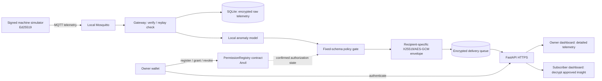

> **v2 supersession (2026-10-26):** The approved native custom-blockchain design in [V2.md](V2.md) governs new implementation. EVM/wallet/MQTT and incompatible v1 tooling/schema requirements below are historical. Completion requires dated v2 evidence, not the legacy checkboxes.

# DESIGN.md — Architecture, Protocol and Threat Model

## 1. Architecture overview



**Data plane:** publisher → MQTT → gateway → local encrypted storage / local AI → filtered encrypted delivery → authenticated subscriber.

**Control plane:** owner wallet registers resource on-chain; gateway checks contract state and local owner-approved policy digest. Only low-rate grant/revoke is on-chain; no high-rate sensor transmission.

## 2. Trust boundaries and threat model

| Boundary | Attacker opportunity | Countermeasure | Not guaranteed |
|---|---|---|---|
| Device → broker/gateway | Impersonation, tamper, replay | Pinned Ed25519 signing key, monotonic sequence, timestamp ±30s, broker ACL | Compromised device / lying sensor |
| Gateway → AI | Untrusted or malformed sensor values | Range validation, fixed feature set, bounded model runtime | Perfect diagnosis |
| AI → output | Model invents private fields or explanations | Strict five-field serialization; forbid arbitrary text/fields | Privacy from all possible inference attacks |
| Owner → chain | Incorrect/malicious grant, frontrunning | Wallet-based control, clear confirmation UI, event versioning | Owner mistakes or stolen wallet |
| Gateway → chain | RPC spoof/outage, stale state | Pin chain ID/address, verify contract call from confirmed block, fail closed | Trustless local execution or unlimited availability |
| Gateway → subscriber | Interception or wrong recipient | X25519 ephemeral ECDH, HKDF, AES-GCM with AAD, wallet-bound public key | Recipient retaining already decrypted information |
| Subscriber → API | ID guessing, mass assignment, unauthorized raw reads | Session auth, owner checks, digest/scope at query and delivery | Compromised gateway machine |
| Local filesystem | SQLite theft, log leakage | AES-GCM encrypted telemetry column, protected master key, log redaction | Metadata leakage, protection with stolen master key |

**Explicit trust assumption:** the local gateway process and its host are trusted with raw data and keys. Blockchain does not make the gateway unable to exfiltrate raw data if compromised.

## 3. Device and onboarding flow

1. Owner creates a local EVM wallet identity for demonstration and an independent Ed25519 key pair for the simulator.
2. Owner generates random bytes32 `resource_id`, calls contract `registerResource(resource_id)`, waits for confirmation.
3. Owner signs wallet-login challenge (`/v1/auth/challenge` → `/verify`) and calls `POST /v1/devices` with resource ID, UUID device ID, Ed25519 public key; gateway verifies on-chain resource ownership.
4. Third party signs their own challenge and registers X25519 receiver public key using `POST /v1/keys`.
5. Gateway records public identities in SQLite. **Never ask for signing or decryption private keys via API.**

## 4. Signed telemetry transport

- MQTT topic: `devices/{device_id}/telemetry` (local-only transport). Device publishes QoS 1, retained=false.
- Unsigned payload fields: `schema_version`, `device_id`, `resource_id`, `sequence`, `issued_at`, `telemetry`.
- `telemetry` fields exactly `temp_c`, `vibration_mm_s`, `rpm`; bounded numeric schema.
- `signature_b64` = Ed25519 signature of canonical unsigned object. Pin public key and device-to-resource mapping in SQLite.
- Reject invalid timestamps/sequence. Save ciphertext and latest sequence in **one transaction**; duplicate QoS 1 delivery cannot create duplicate events.
- Test timestamp skew and out-of-order handling. MVP intentionally rejects out-of-order packets rather than implementing a reorder window.

## 5. AI and privacy processing

1. Gateway decrypts accepted reading **in process memory only** and normalizes features with versioned rules.
2. Rule baseline and CPU-only Isolation Forest produce anomaly decision / numeric internal score.
3. A candidate event is created only for detected anomalies. Severity derives from documented calibrated deterministic thresholds, not a claimed probability.
4. Candidate is **not shareable**. Policy gate builds a **new** object with exactly `event_id`, `event_type`, `severity`, `observed_at`, `model_version`.
5. Event type must appear in the local immutable/approved policy; event schema and recipient must match on-chain grant `policyDigest` and scope=1.
6. A gateway must be able to process local telemetry while all external disclosure is disabled.

## 6. Smart contract and authorization

Contract interface intent (exact ABI to be generated from source):

```solidity
registerResource(bytes32 resourceId)
grant(bytes32 resourceId, address reader, bytes32 policyDigest, uint64 expiresAt)
revoke(bytes32 resourceId, address reader)
ownerOf(bytes32 resourceId) returns (address)
getGrant(bytes32 resourceId, address reader)
    returns (bytes32 policyDigest, uint64 expiresAt, uint32 version, bool active, uint8 scope)
```

- `registerResource` assigns `msg.sender` as owner once; reassignment is out of MVP.
- `grant` only owner; reader not zero address; expiry in future; on-chain `scope` for MVP always `READ_INSIGHT = 1`; increments version and emits event.
- `revoke` only owner; increments version, marks grant inactive, emits event. Expiration checked by gateway and may also be enforced by contract view/helper.
- Policy manifest is off-chain; contract stores only SHA-256 bytes32 digest, not JSON body.
- Gateway re-computes digest, verifies resource owner, recipient wallet, expiry, active flag, scope and exact hash from confirmed state before encrypting/serving.
- The chain is **local Anvil**: replicated consensus and independent validators are not demonstrated. Anvil reset changes contract history; record chain ID and deployment address and rebootstrap.

### Synchronization rules

- Contract grant/revoke transaction **pending** != effective change.
- Gateway verifies receipt status, correct chain ID/address, confirmed block and current `getGrant` state (do not trust user-supplied `tx_hash`).
- Gateway locally activates/invalidates corresponding policy only after successful verification; always checks fresh chain state again before reader delivery.
- On an RPC failure, no new third-party delivery or read, even if a prior snapshot exists; retain local ingest capability. Small caches may aid UI rendering but not authorize disclosure when network checks fail.
- Revocation increments a local key epoch and prevents pending/unread ciphertext from being served; future authorized recipients get independently generated envelope keys. Previously downloaded ciphertext/plaintext cannot be recalled.

## 7. Per-recipient encryption design

For **each delivery/recipient**:

1. Validate current grant and recipient's authenticated wallet-bound X25519 public key.
2. Generate fresh ephemeral X25519 key pair.
3. Compute ECDH shared secret, derive 32-byte AES key via HKDF-SHA256 using domain-separated `info` with `recipient_wallet`, `resource_id`, `event_id`, `policy_version`, `key_epoch`.
4. Generate random 96-bit nonce; encrypt canonical five-field insight with AES-256-GCM. Bind envelope metadata as authenticated additional data (AAD).
5. Persist encrypted envelope and necessary **public** metadata only; never persist ephemeral private key or AES session key.
6. Subscriber uses their X25519 private key to derive AES key and decrypt. Another recipient must fail. The key stays in tab memory; the subscriber may explicitly download a plaintext backup and restore it from a local file. Only the derived public key is sent to the gateway (ADR-014).

A new ephemeral key is used for each envelope; the `key_epoch` increments on revocation for tracking future generations. There is no shared group encryption key in the MVP. Key registration/rotation requires fresh wallet-authenticated proof of control; an API caller cannot replace another wallet's public key.

## 8. HTTP/web UX flows

- Login via wallet challenge; gateway sets short-lived HttpOnly cookie; CSRF token + allowed-origin check for state-changing calls.
- Owner dashboard: register device, plot detailed local readings, propose permitted fields and expiry, view tx pending/confirmed/synced states, revoke.
- Subscriber dashboard: explicitly back up and register an X25519 key, see assigned active resource, poll encrypted insight, decrypt locally and show five-field summary. Restore reads the subscriber's user-managed key file locally; the application does not persist or upload private key material.
- API rechecks rights; visually hiding buttons is insufficient.
- Avoid chain wallet private-key custody on gateway; user signs contract transactions from the wallet UI.

## 9. Failure semantics

| Failure | Behavior |
|---|---|
| MQTT unavailable | Sensor retries with bounded backoff; no claim of lossless buffering beyond specified simulator policy. |
| Invalid signed message | Reject before database write/inference; safe error metric. |
| AI model unavailable | Fallback to **documented deterministic baseline**, marked by distinct `model_version`; never a made-up AI conclusion. |
| SQLite unavailable | Fail ingest safely; do not publish unchecked event. |
| Anvil RPC down | Third-party authorization = unknown → deny; owner local viewing may remain available by separate owner authentication and local ownership proof rules. |
| Contract address/chain ID mismatch | Fail startup or disable third-party disclosure. |
| Grant pending | Do not activate new access; existing permissions assessed from confirmed state. |
| Revocation confirmed | Block fresh and queued unread delivery; replace key epoch for subsequent authorized recipients. |
| Recipient key missing | No ciphertext delivered; show explicit key-registration error. |
| Expired wallet challenge | Require new challenge; never silently refresh by insecure channel. |

## 10. Privacy and security caveats

- Recipient may infer occupancy/operations from anomaly timing, even without raw measurements.
- Wallet addresses, resource IDs and policy hashes may enable linkability. Use synthetic identifiers and consider deploying to a permissioned network only after threat/privacy assessment.
- Chain verifies a grant but cannot verify physical readings, model correctness, completeness of the gateway's logs or absence of secret off-platform sharing.
- Owner detail access is still sensitive; gateway host compromise defeats its privacy boundary.
- Do not transmit sensitive telemetry to hosted LLMs. Natural-language policy drafting is future optional; only human-approved deterministic policies authorize releases.

## 11. Evaluation comparison

Compare the same event pipeline under (a) a centralized local ACL adapter and (b) contract-backed authorization adapter. Measure denial correctness, grant/revoke propagation, RPC calls, transaction latency/cost and delivery overhead. Do not infer blockchain superiority without empirical results.
